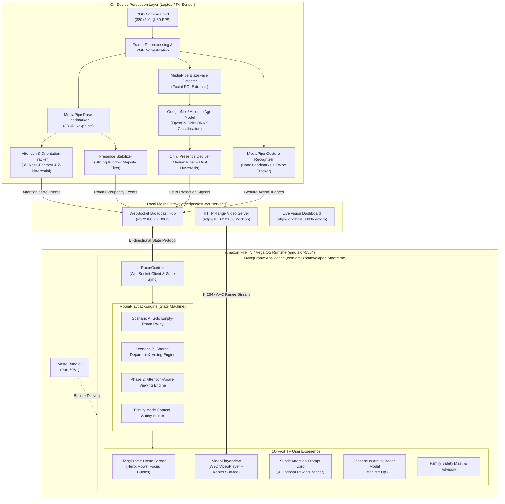
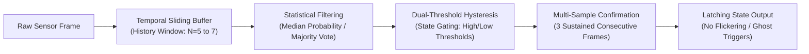
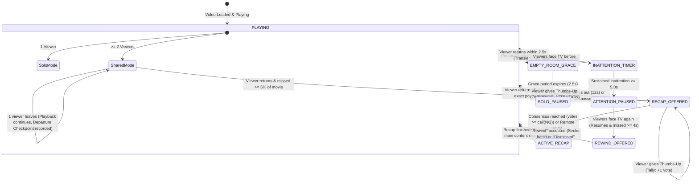

# LivingFrame
### Intelligent, Ambient Room-Aware Media Experience for Amazon Fire TV (Vega OS)

[](https://developer.amazon.com/apps-and-games/fire-tv)
[](https://developer.amazon.com)
[](https://developers.google.com/mediapipe)
[](https://opencv.org/)
[](https://www.w3.org/TR/html52/semantics-embedded-content.html)
[](#10-privacy-security--edge-processing-guarantees)

> *"The television should not merely display content in isolation; it should perceive and adapt naturally to the living room environment and the people sharing the space."*

---

## 1. Product Vision & Overview

**LivingFrame** is a next-generation media experience designed specifically for **Amazon Fire TV** devices running **Vega OS** (Kepler runtime). By pairing a high-performance 10-foot TV user interface with a lightweight, privacy-preserving on-device computer vision pipeline, LivingFrame transforms the television into an ambient, context-aware room companion.

Traditional smart TVs are passive screens: if viewers look away to converse, leave the room, or if children enter during adult-rated scenes, playback marches forward blindly. Viewers return lost, scramble for the remote, or risk exposing young family members to sensitive content.

LivingFrame eliminates these frictions autonomously:
1. **Attention-Aware Viewing**: Senses whether viewers are actively watching or turned away. If more than 70% of viewers are distracted for a sustained period, it gently pauses and presents a subtle prompt. When attention returns, it automatically resumes and offers an optional catch-up rewind.
2. **Presence-Adaptive Playback**: Differentiates between solo viewing (pausing cleanly on departure, resuming instantaneously on return) and shared viewing (letting remaining viewers watch uninterrupted while recording departure checkpoints for arrival recaps).
3. **Consensus-Driven Arrival Recaps ("Catch Me Up")**: When a departed viewer returns to a shared session, a non-intrusive banner offers a spoiler-free recap. Viewers can vote via hand gestures (thumbs-up) or remote control, requiring a consensus before opening the recap modal.
4. **Automated Family Protection**: Passively detects the presence of children using body-proportion heuristics and local facial age classification, immediately blanking out and pausing scenes tagged with adult content.
5. **Hands-Free Gesture Control**: Enables seamless natural interactions (raise hand to pause/play, swipe to scrub, thumbs-up to approve) without reaching for physical hardware.
6. **Zero-Cloud Privacy**: All visual perception and inference occurs strictly in local memory at the edge—no video frames or facial identities are ever transmitted over the internet or saved to disk.

---

## 2. End-to-End System Architecture

LivingFrame is architected as a distributed local mesh connecting the **Amazon Vega OS Runtime** with local media services and an on-device computer vision engine.



### Local Mesh Network & Port Topology

| Port | Protocol | Service | Host Address | Vega Emulator Address | Description |
|---|---|---|---|---|---|
| **`8080`** | `HTTP / WS` | Video Server & WS Mesh (`test_ws_server.js`) | `http://localhost:8080` | `http://10.0.2.2:8080` | Streams catalog MP4 titles via HTTP 206 Partial Content and broadcasts room state events over WebSocket |
| **`8080`** | `HTTP` | Vision Telemetry Dashboard | `http://localhost:8080/camera` | N/A | Interactive web console displaying live camera feed, bounding boxes, attention status, and room logs |
| **`8081`** | `HTTP` | Metro JavaScript Bundler | `http://localhost:8081` | `http://10.0.2.2:8081` | Compiles and serves the React Native Kepler application bundle to the Vega device |
| **`5554`** | `VDA / TCP` | Vega Virtual TV Device | `emulator-5554` | `localhost` | Fire TV virtual device running Vega OS 1.2 with QEMU acceleration |

---

## 3. On-Device Vision & Machine Learning Models

LivingFrame executes entirely on edge processors with zero cloud API dependencies. The vision engine combines 4 specialized lightweight models orchestrated within `scripts/webcam_sensor.py`:

| Model Name | Source / Format | Size | Function in LivingFrame | Inference Engine |
|---|---|---|---|---|
| **MediaPipe Gesture Recognizer** | `gesture_recognizer.task` | ~8.4 MB | Identifies discrete hand gestures (`Thumb_Up`, `Open_Palm`, etc.) and continuous directional swipes | MediaPipe Tasks Vision |
| **MediaPipe Pose Landmarker** | `pose_landmarker_full.task` | ~9.4 MB | Tracks 33 full-body 3D coordinates ($x, y, z$) for room presence, child body proportion estimation, and 3D head yaw orientation | MediaPipe Tasks Vision |
| **MediaPipe BlazeFace** | `blaze_face_full_range.tflite` | ~0.9 MB | Multi-scale frontal and profile face detector with sub-millisecond bounding box localization | MediaPipe Face Detector |
| **GoogLeNet / Adience Age Model** | `age_googlenet.onnx` | ~43.5 MB | Deep convolutional neural network classifying facial crops into 8 standard demographic age brackets | OpenCV DNN Module |

---

### Technical Deep Dive: Viewer Orientation & Attention Estimation

Rather than loading a heavyweight head-pose network, LivingFrame derives orientation by analyzing the 3D landmark geometry from `pose_landmarker_full.task`:

```text
       [Facing TV: Attentive]                     [Turned Away: Distracted]
             (Nose: z = -0.08)                                     (Ear Right)
                   ▲                                                   ▲
                   │                                                   │
     (Ear Left) ───┼─── (Ear Right)               (Ear Left) ──────────┴────► (Nose: z = +0.03)
      z = 0.00           z = 0.00                  z = 0.00                    z behind ears!
   Nose is centered and in FRONT of ears        Nose shifted past ear span and BEHIND ears
```

1. **Landmark Extraction**: Queries Nose ($0$), Left Ear ($7$), Right Ear ($8$), Left Shoulder ($11$), and Right Shoulder ($12$) with corresponding visibility scores.
2. **Ear Occlusion & Back-of-Head Detection**:
   If both ears have visibility $< 0.25$ or shoulder vectors indicate posterior view, the viewer is turned away (`away`).
3. **3D Depth Differential ($Z$-Axis)**:
   MediaPipe outputs camera-relative depth ($Z$), where negative values indicate proximity to the lens. When facing the TV, $z_{\mathrm{nose}} < z_{\mathrm{ears}}$. If $z_{\mathrm{nose}} > z_{\mathrm{ears}} + 0.02$, the nose is recessed behind the ear baseline, indicating the head is turned away.
4. **Horizontal Yaw Ratio**:
   Measures the lateral offset of the nose relative to the midpoint of the ears:
   $$\mathrm{YawRatio} = \frac{|x_{\mathrm{nose}} - x_{\mathrm{mid}}|}{\frac{1}{2} \cdot \mathrm{Span}_{\mathrm{ears}}}$$
   - When facing the TV: $\mathrm{YawRatio} \le 0.65 \implies$ facing toward the TV (Attentive).
   - When rotated $> 45^\circ$ sideways: $\mathrm{YawRatio} > 0.65 \implies$ turned away from the TV (Distracted).

---

### Signal Processing, Debouncing & Stabilization

Raw computer vision sensors suffer from lighting fluctuations, frame dropouts, and transient occlusions. LivingFrame incorporates mathematical stabilization filters:



1. **`PresenceStabilizer` (Occupancy Counting)**:
   - Maintains a circular buffer of the last 5 visible pose counts.
   - Evaluates a majority vote filter to eliminate single-frame detection dropouts.
   - Enforces a $1.5\text{s}$ cooldown between discrete `person_entered` and `person_left` events to avoid rapid double-triggering.
2. **`ChildPresenceDecider` (Age Estimation Stability)**:
   - Computes probability mass across child brackets `(0-2)`, `(4-6)`, `(8-12)` from the OpenCV DNN softmax layer.
   - Applies median smoothing across the last 7 frames.
   - Uses dual-threshold hysteresis: activation requires probability $\ge 0.55$; deactivation requires probability $\le 0.35$.
   - Requires 3 consecutive confirmed frames before modifying room safety state.
3. **`AttentionTracker` (Hysteresis & Thresholding)**:
   - Computes inattention ratio: $\frac{\text{distractedCount}}{\text{totalViewers}}$.
   - Triggers distraction when ratio $> 0.70$ ($70\%$).
   - Sustains state across a 3-frame confirmation window before notifying the Fire TV app.

---

## 4. Full Product Feature Matrix

| Feature | Category | Trigger Mechanism | Playback & UI Action | User Control / Override |
|---|---|---|---|---|
| **Attention-Aware Pause** | Phase 2 Attention | $> 70\%$ of viewers turned away for $\ge 5.0\text{s}$ | Smoothly pauses video; renders subtle prompt card: *"Playback paused · Viewers appear turned away"* | Click **"Keep Playing 👍"** or give thumbs-up gesture |
| **Attention Thumbs-Up Override** | Phase 2 Attention | Any viewer presents a `thumbs_up` gesture | Immediately resumes playback and sets override latch; prevents pauses while viewers talk | Normal remote controls |
| **Catch-Up Rewind Offer** | Phase 2 Attention | Viewers face TV again after missing $\ge 4.0\text{s}$ of content | Resumes playback automatically; renders bottom banner: *"WELCOME BACK · Catch up on Xs missed?"* | Remote Left/Right: **"Rewind Xs"** (seeks back) or **"Dismiss"** |
| **Solo Viewer Departure** | Room Awareness | Occupancy transitions from $1 \to 0$ viewers | Enters $2.5\text{s}$ grace period. If room stays empty, pauses and logs `SoloPauseCheckpoint` | Returns to room: auto-resumes from exact checkpoint with NO modal |
| **Shared Departure Checkpoint** | Room Awareness | Occupancy drops but viewers remain ($N \to N-1$) | Playback continues uninterrupted for remaining viewers; records departure timestamp | None required |
| **Consensus Arrival Recap** | Room Awareness | Departed viewer returns ($N-1 \to N$) after missing $\ge 5\%$ of title | Non-blocking banner: *"SOMEONE'S BACK · Catch them up?"* | Thumbs-up gesture from viewers or remote **"Show Recap"**; requires $\lceil N/2 \rceil$ consensus |
| **Family Mode Child Protection** | Content Safety | Child enters during adult-tagged scene (`TV-14`, `TV-MA`) | Instantly pauses playback; covers screen with black protective vignette and advisory warning | Turning off Family Mode or remote **"Resume anyway"** |
| **Hands-Free Gesture Control** | Interaction | Raised open hand held steady for $0.4\text{s}$ | Toggles Play / Pause with haptic-style visual HUD badge | Dedicated **"GESTURES OFF/ON"** toggle in player |
| **Directional Scrubbing** | Interaction | Horizontal hand swipe left or right | Scrubs video forward or backward by $5.0\text{s}$ with smooth seek bar animation | Remote Rewind / Fast-Forward keys |
| **Hardware Video Pipeline** | Video Core | `@amazon-devices/react-native-w3cmedia` | Full-screen hardware-accelerated video decoding via `KeplerVideoSurfaceView` | 1-Click full-screen toggle; 5s auto-hide HUD |

---

## 5. Playback Intelligence State Machine

The core room behavior is governed by the deterministic state machine in [src/room/playbackIntelligence.ts](file:///home/supanroy/Projects/LivingFrame/src/room/playbackIntelligence.ts):



### Policy Actions & Event Payloads

| Action Type | Trigger Condition | Engine Payload Parameters | Resulting TV Behavior |
|---|---|---|---|
| `PAUSE_SOLO` | Room empty $> 2.5\text{s}$ | `checkpoint: SoloPauseCheckpoint` | Video pauses; HUD displays: *"Room empty · Playback paused"* |
| `RESUME_SOLO` | Solo viewer returns | `positionSec: number` | Seeks to exact second, plays video; HUD: *"Viewer returned · Resuming"* |
| `RECORD_SHARED_DEPARTURE` | $N \to N-1$ viewers ($N-1 \ge 1$) | `checkpoint: SharedDepartureCheckpoint` | Playback unaffected; departure position saved silently |
| `OFFER_RECAP` | Viewer returns after missing content | `offer: RecapOfferState` | Non-blocking banner rendered; movie keeps playing |
| `START_RECAP` | Consensus reached or remote accepted | `resumePositionSec, metadata` | Pauses main video; displays spoiler-free character/scene recap modal |
| `PAUSE_ATTENTION` | Inattention $> 70\%$ for $\ge 5.0\text{s}$ | `checkpoint: AttentionDistractionCheckpoint` | Pauses video; renders subtle card with *"Keep Playing 👍"* button |
| `OVERRIDE_ATTENTION` | Thumbs-up gesture or button click | `resume: true` | Clears pause; unlatches attention lock; resumes playback |
| `RESUME_ATTENTION` | Viewers face TV again | `autoResume, offerReplay, missedSec` | Resumes playback; renders optional bottom rewind banner if missed content $\ge 4.0\text{ s}$ |

---

## 6. Remote Navigation & Interaction Reference

The TV UI is designed according to the Amazon Fire TV 10-foot design guidelines, using high-contrast focus rings, custom focus guides (`TVFocusGuideView`), and ergonomic remote mapping:

```text
 ┌─────────────────────────────────────────────────────────────┐
 │                      AMAZON FIRE TV REMOTE                  │
 │                                                             │
 │                           ▲ UP                              │
 │                     ◄ LEFT  ● ENTER  ► RIGHT                │
 │                          ▼ DOWN                             │
 │                                                             │
 │                     [BACK]    [PLAY/PAUSE]                  │
 │                     [REW]     [FAST-FWD]                    │
 └─────────────────────────────────────────────────────────────┘
```

### Remote Key Action Matrix

| Remote Key | Home Screen Context | Video Player Context | Modal / Alert Context |
|---|---|---|---|
| **DPAD Left / Right** | Navigate across content cards in row | Rewind / Fast-Forward 10 seconds | Switch between modal action buttons |
| **DPAD Up / Down** | Switch between Hero banner & rows | Reveal / Hide player HUD controls | Vertical menu item navigation |
| **Select / Enter** | Launch details modal for selected card | Toggle Play / Pause | Confirm highlighted action (e.g. *Rewind*, *Keep Playing*) |
| **Play / Pause Key** | Instantly play featured hero title | Toggle Play / Pause | Unpause / dismiss overlay |
| **Rewind Key** | N/A | Scrub backward 10 seconds | N/A |
| **Fast-Forward Key** | N/A | Scrub forward 10 seconds | N/A |
| **Back / Escape** | Exit app / return to previous screen | Exit video player to Home screen | Dismiss active modal or overlay |

---

## 7. Natural Hand Gesture Reference

When **Gesture Control** is enabled, viewers can interact directly with the television without reaching for the physical remote:

| Gesture Name | Visual Pose | Function | Technical Threshold |
|---|---|---|---|
| **Thumbs Up** | 👍 Fist with thumb pointing upward | **Attention Override** (bypass distraction pause) & **Recap Vote** (+1 consensus vote) | Hand confidence $\ge 0.70$, $2.0\text{s}$ duplicate cooldown |
| **Raise Hand (Open Palm)** | ✋ Open palm facing camera | **Toggle Play / Pause** | Palm open, 5 extended fingers held stable for $0.4\text{s}$ |
| **Swipe Right** | 🫱 Rapid hand motion left-to-right | **Fast-Forward 5s** | Horizontal velocity $v_x > 0.45$, displacement $\Delta x > 0.12$ |
| **Swipe Left** | 🫲 Rapid hand motion right-to-left | **Rewind 5s** | Horizontal velocity $v_x < -0.45$, displacement $\Delta x < -0.12$ |
| **Point Up** | ☝️ Closed fist with index extended | **Summon Scene Trivia & Character Bios** | Index tip elevated, confidence $\ge 0.75$ |

---

## 8. REST & WebSocket API Protocol

LivingFrame features an embedded HTTP and WebSocket gateway ([scripts/test_ws_server.js](file:///home/supanroy/Projects/LivingFrame/scripts/test_ws_server.js)) facilitating communication between the vision sensor and the Fire TV application.

### REST Endpoints

| Endpoint | Method | Parameters | Description |
|---|---|---|---|
| `/health` | `GET` | None | Returns JSON server status, connected client count, and vision engine heartbeat |
| `/videos/:id.mp4` | `GET` | `Range: bytes=start-end` | HTTP 206 Partial Content video streaming endpoint serving 1080p MP4 assets |
| `/camera` | `GET` | None | Real-time web dashboard displaying camera stream, bounding boxes, and attention metrics |
| `/frame` | `POST` | Binary JPEG body + headers | Ingests live webcam frames with `X-Attentive-Count` and `X-Is-Distracted` headers |
| `/room/attention` | `GET` | `?distracted=0&attentive=1` | Deterministic mock endpoint simulating viewer orientation and attention changes |
| `/room/person_entered`| `GET` | `?count=2` | Deterministic mock endpoint simulating person entry into the living room |
| `/room/person_left` | `GET` | `?count=1` | Deterministic mock endpoint simulating person departure |
| `/room/gesture` | `GET` | `?gesture=thumbs_up` | Deterministic mock endpoint triggering gesture actions |
| `/vision/start` | `GET` | None | Spawns the local Python webcam vision sensor subprocess |
| `/vision/stop` | `GET` | None | Gracefully terminates the Python vision sensor subprocess |

### WebSocket Event Protocol (`ws://10.0.2.2:8080`)

```json
// Attention State Event (Phase 2)
{
  "type": "attention_state",
  "source": "sensor",
  "message": "Viewers facing TV (1/1) · Attentive",
  "payload": {
    "attentiveCount": 1,
    "distractedCount": 0,
    "isDistracted": false,
    "inattentiveRatio": 0.0,
    "viewerCount": 1
  },
  "timestamp": 1792590708117
}

// Occupancy State Event
{
  "type": "person_entered",
  "source": "sensor",
  "message": "Room presence changed: 2 viewers",
  "payload": {
    "personCount": 2,
    "previousCount": 1
  },
  "timestamp": 1792590800000
}

// Gesture Detection Event
{
  "type": "gesture_detected",
  "source": "sensor",
  "message": "Gesture: thumbs_up (0.92)",
  "payload": {
    "gesture": "thumbs_up",
    "confidence": 0.92,
    "handedness": "Right"
  },
  "timestamp": 1792590815000
}
```

---

## 9. Installation, Build & Demonstration Guide

### Prerequisites
- **Node.js**: v20+ with npm
- **Python**: 3.10+ with virtual environment
- **Vega SDK**: Installed with `vega` CLI available in PATH
- **Linux Environment**: Ubuntu 22.04+ or compatible distribution

---

### Step 1: Environment Setup & Dependencies

```bash
# 1. Install Node.js dependencies
npm install

# 2. Activate Python environment and install vision packages
source .venv/bin/activate
pip install mediapipe opencv-python numpy websocket-client

# 3. Ensure local models are present in models/ directory:
# - models/gesture_recognizer.task
# - models/pose_landmarker_full.task
# - models/blaze_face_full_range.tflite
# - models/age_googlenet.onnx
```

---

### Step 2: Start Local Services

Open **two terminal windows**:

```bash
# Terminal 1: Start Video Server & WebSocket Hub (Port 8080)
node scripts/test_ws_server.js

# Terminal 2: Start Metro JavaScript Bundler (Port 8081)
npm start
```

---

### Step 3: Compile & Deploy on Vega Virtual Device

```bash
# 1. Start the Vega Virtual Device
vega virtual-device start

# 2. Verify emulator connectivity
vega device list
# Expected output:
# VirtualDevice : tv - x86_64 - OS - amazon-...

# 3. Compile the debug package (.vpkg)
npm run build:debug

# 4. Install package onto the Virtual Device
vega device install-app -p build/private/kepler/@amazon-devices/livingframe/undefined/vega/x86_64/Debug/@amazon-devices/livingframe_x86_64.vpkg

# 5. Launch the application
vega device launch-app -a com.amazondeveloper.livingframe.main
```

---

### Step 4: Live Demonstration Workflows

#### Demonstration A: Attention-Aware Viewing (Phase 2)
1. Launch any title (e.g. *Behind the Screams*) on the TV.
2. Start the webcam sensor:
   ```bash
   .venv/bin/python scripts/webcam_sensor.py --camera 0
   ```
3. Open `http://localhost:8080/camera` to view the live attention bounding boxes.
4. Turn your head sideways or look away from the camera for **5 seconds**:
   - Playback pauses smoothly.
   - The subtle prompt card appears: `[ATTENTION-AWARE VIEWING] Playback paused · Viewers appear turned away` with `Keep Playing 👍`.
5. **Test Thumbs-Up Override**:
   - Present a thumbs-up gesture to the webcam (or select *Keep Playing* via remote).
   - Playback immediately resumes and stays active even while looking away.
6. **Test Catch-Up Rewind**:
   - Look away again for 5 seconds until it pauses.
   - Turn your face back to the TV.
   - Playback resumes automatically, and the banner appears: `"WELCOME BACK · Catch up on 5s missed?"` with **"Rewind 5s"** and **"Dismiss"**. Selecting *Rewind* jumps back to the exact second you looked away.

#### Demonstration B: Deterministic Verification (Without Webcam)
You can trigger every room scenario programmatically via curl:

```bash
# Simulate 1 viewer watching attentive
curl -s "http://localhost:8080/room/attention?distracted=0&attentive=1"

# Simulate viewer looking away (distracted)
curl -s "http://localhost:8080/room/attention?distracted=1&attentive=0"
# (Wait 5 seconds: TV pauses with prompt card)

# Override with thumbs-up gesture
curl -s "http://localhost:8080/room/gesture?gesture=thumbs_up"
# (TV resumes playback immediately)

# Simulate returning attention
curl -s "http://localhost:8080/room/attention?distracted=0&attentive=1"
# (TV offers rewind banner)

# Simulate solo viewer leaving room
curl -s "http://localhost:8080/room/person_left?count=0"
# (After 2.5s grace period: pauses with "Room empty")

# Simulate viewer returning
curl -s "http://localhost:8080/room/person_entered?count=1"
# (Instantly resumes without recap modal)
```

---

## 10. Automated Test Suites & Verification

LivingFrame includes comprehensive end-to-end unit and component integration tests validating all state machine transitions and vision algorithms:

```bash
# Execute Jest React Native & TypeScript test suite
npm test

# Expected Output:
# PASS test/roomAwarePlayback.spec.tsx (10 passed)
# PASS test/playbackIntelligence.spec.ts (23 passed)
# Test Suites: 10 passed, 10 total
# Tests:       92 passed, 92 total

# Execute Python computer vision & stabilization test suite
.venv/bin/python test/presence_stabilizer_test.py

# Expected Output:
# == PresenceStabilizer == (16 passed)
# == count_visible_poses == (4 passed)
# == estimate_child_likelihood == (5 passed)
# == ChildPresenceDecider == (4 passed)
# == Age model helpers == (12 passed)
# == _detect_swipe == (6 passed)
# == Phase 2: estimate_pose_orientation == (4 passed)
# == Phase 2: AttentionTracker == (8 passed)
# 59/59 passed
```

---

## 11. Technical Documentation

Additional technical specifications and documentation are available in the [`docs/`](./docs) directory:

| Document | Focus & Key Topics Covered |
|:---|:---|
| [**System Architecture**](./docs/ARCHITECTURE.md) | Decoupled edge sensory topology, Vega OS package manifest (`manifest.toml`), Kepler W3C Media pipeline, and local WebSocket/HTTP mesh |
| [**On-Device Vision Pipeline**](./docs/VISION_PIPELINE.md) | 3D landmark geometry (nose-ear yaw ratio & Z-depth), multi-model edge deployment, 7-frame median filter, and dual-hysteresis child classification |
| [**Playback Intelligence Specification**](./docs/PLAYBACK_INTELLIGENCE.md) | Deterministic state machine, solo departure grace periods, shared viewing arrival recaps, consensus voting math, and attention-aware playback |
| [**System API & Protocol Reference**](./docs/API_REFERENCE.md) | Complete JSON schema specifications for WebSocket events (`/room/state`), REST endpoints, and media catalog structures |
| [**Developer Friction Log & Suggestions**](./docs/FRICTION_LOG.md) | Detailed evaluation of Vega OS & Kepler SDK, native surface race conditions, React 18 focus bleed, and actionable feature requests for Amazon |

---

## 12. Privacy, Security & Edge Processing Guarantees

LivingFrame was built strictly under a **Privacy-by-Design** mandate:

1. **Pure Edge Execution**: All neural network inferences (MediaPipe Pose, BlazeFace, GoogLeNet) execute in volatile CPU/GPU RAM on the local host or edge device. Zero cloud inference APIs are involved.
2. **Transient Frame Lifecycle**: Incoming camera frames are decoded into memory buffers, analyzed, and immediately garbage-collected. No video frames, face crops, or raw audio are ever persisted to disk.
3. **No Biometric Identification**: The vision system does not perform facial recognition, facial template extraction, or identity tracking. It computes non-invertible geometric ratios (ear-to-nose distances, shoulder-to-head spans) that cannot be used to identify individuals.
4. **Local Mesh Isolation**: The WebSocket and video streaming protocol operates strictly over the private local subnet (`10.0.2.2` / `localhost`), with no external network exposure.
5. **Physical Kill Switches**: The TV interface provides immediate hardware-level software switches (**GESTURES OFF/ON** and **FAMILY MODE OFF/ON**) that fully release camera hardware resources when toggled off.

---

## 13. License & Trademarks

- **License**: Released under the [MIT License](./LICENSE) &copy; 2026 Supan Roy.
- **Trademarks**: Amazon, Fire TV, Vega OS, Kepler, and all related logos are trademarks of Amazon.com, Inc. or its affiliates. MediaPipe is a trademark of Google LLC.
