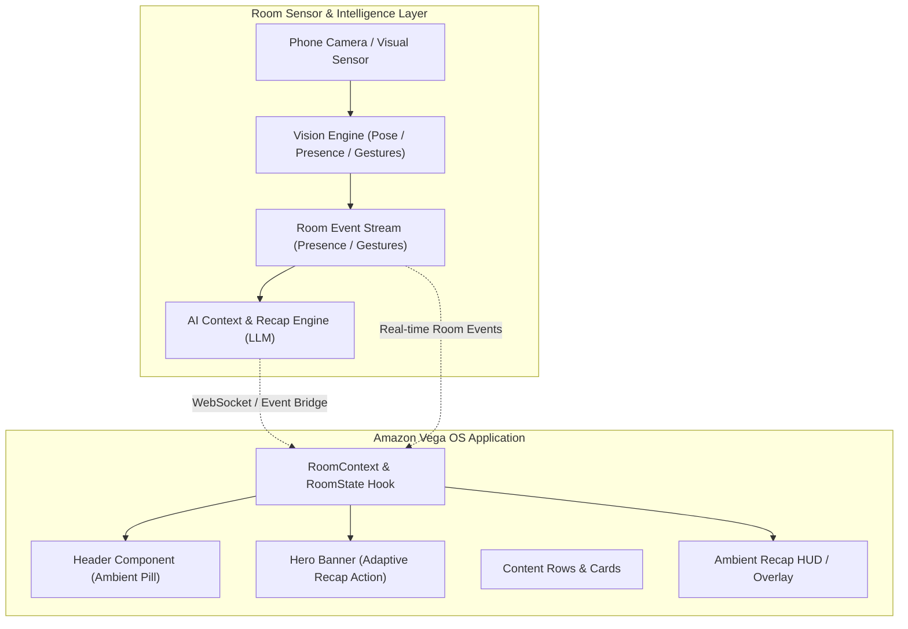

# LivingFrame Architecture: Room Awareness & AI Integration

## 1. Overview

LivingFrame separates the TV presentation layer from the ambient room intelligence layer. This ensures the TV home screen remains ultra-responsive, 60fps smooth, and unaffected by heavy computer vision or network latency.

---

## 2. Extension Points in Current Codebase

### A. Room State Provider (`src/context/RoomContext.tsx`)
- Currently holds `roomState` (viewers present, sensor status, last event, ambient mode).
- In Milestone 2 & 3, `RoomProvider` will connect to a lightweight local WebSocket or MQTT client listening for events emitted by the mobile sensor layer.
- Components subscribe via `useRoom()` without any architectural changes needed.

### B. Room Event Contract (`src/types/room.ts`)
- Defines standard event schemas:
  - `viewer_entered`: triggers gentle arrival recap notifications.
  - `viewer_left`: adapts audio/volume profile.
  - `gesture_detected`: maps gestures (e.g., `hand_raised`) to contextual character bios and scene trivia.
  - `recap_requested`: triggers `AmbientRecapModal` with AI-synthesized context.

### C. Catalog AI Contextual Metadata (`src/types/catalog.ts` & `src/data/catalogData.ts`)
- Each `MediaItem` already includes `aiContextHint` fields.
- In future milestones, these hints will be dynamically injected by Amazon Bedrock or Google Gemini based on the active scene timestamp and the arriving viewer's profile.

---

## 3. Recommended Implementation Roadmap

1. **Milestone 1 (Complete)**:
   - Clean Vega OS foundation on Kepler framework.
   - Cinematic TV Home Screen with remote navigation, dynamic hero spotlight, curated content rows, and details modal.
   - RoomContext hooks and Ambient Recap preview dialog.

2. **Milestone 2 (Sensor Connection)**:
   - Lightweight web camera sensor or phone companion app broadcasting JSON events (`{ type: "viewer_entered", count: 2 }`).
   - Integration with `RoomProvider` to update the Ambient Pill dynamically.

3. **Milestone 3 (AI Intelligence & Recap Engine)**:
   - LLM-generated scene summaries and character relationship maps.
   - Adaptive 15-to-30 second spoiler-free recaps triggered on arrival.

4. **Milestone 4 (Interactive TV Experience & Polish)**:
   - Picture-in-picture video playback with non-intrusive recap overlays.
   - Gesture-based remote actions (hand raise = trivia, wave = dismiss).
