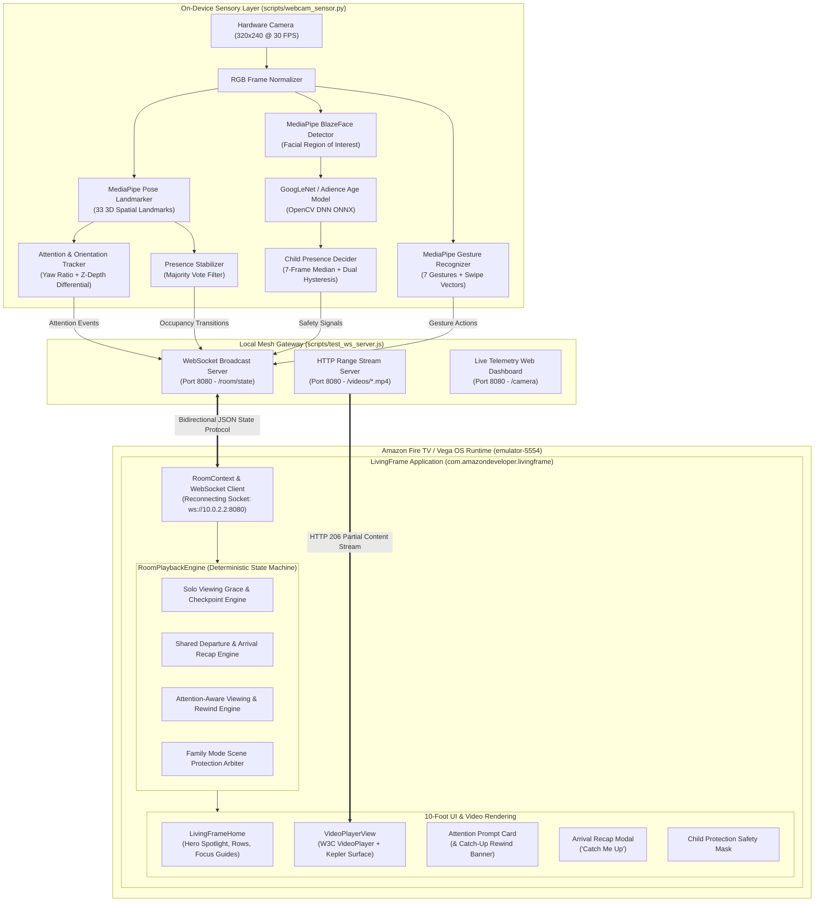

# LivingFrame System Architecture

**LivingFrame** is an intelligent, ambient room-aware media application developed for **Amazon Fire TV** devices running **Vega OS** (Kepler framework).

This document details the architectural principles, process isolation, local mesh topology, component hierarchy, and dataflow that govern LivingFrame.

---

## 1. Architectural Philosophy & Design Principles

1. **Decoupled Edge Computing (Zero-Latency TV UI)**:
   The TV presentation layer is completely isolated from computer vision processing. The React Native / Kepler application runs uninterrupted at a consistent 60 FPS, while compute-intensive video frames and neural network inferences remain strictly confined to the sensory background layer.
2. **Deterministic State Synchronization**:
   Room perception is modeled as discrete, debounced state transitions over a local WebSocket mesh rather than raw continuous streams. The TV application consumes clean, high-confidence room events (`person_entered`, `attention_state`, `gesture_detected`) rather than raw sensor telemetry.
3. **Local Mesh Privacy (Zero Cloud)**:
   No video feeds, biometric facial embeddings, or telemetry leave the local subnet. All machine learning executes on local volatile RAM, and communication takes place over direct loopback interfaces (`10.0.2.2` / `localhost`).
4. **Hardware-Accelerated Native Media Pipeline**:
   Media playback bypasses the JavaScript bridge for video frame rendering, utilizing `@amazon-devices/react-native-w3cmedia` to interface directly with Vega OS hardware decoders and native surface planes.

---

## 2. End-to-End System Topology



---

## 3. Vega OS & Kepler Runtime Integration

LivingFrame is packaged as a native Vega package (`.vpkg`) targeting the `tv` profile of **Vega OS 1.2**.

### Package Manifest (`manifest.toml`)
The application defines an interactive component operating within the essential framework slice:
```toml
[package]
name = "com.amazondeveloper.livingframe"
version = "0.1.0"

[components]
[[components.interactive]]
id = "com.amazondeveloper.livingframe.main"
runtime-module = "/com.amazon.kepler.runtime.react_native_kepler_4@IReactNativeKepler_0"
launch-type = "singleton"
categories = ["com.amazon.category.main", "com.amazon.category.kepler.media"]

[[needs.service]]
id = "/com.amazon.kepler.w3cmedia_2@IW3cmedia_3"
```

### Video Surface Architecture
Video decoding utilizes native platform surfaces via `@amazon-devices/react-native-w3cmedia`:
- `VideoPlayer`: Encapsulates native playback controls (`play()`, `pause()`, `currentTime`, `duration`, `load()`).
- `KeplerVideoSurfaceView`: Allocates the native hardware video composition plane (`handleSurfaceCreated`).
- Surface handles are passed directly to `player.setSurfaceHandle(handle)`, allowing zero-copy direct memory video rendering under the React Native UI view hierarchy.

---

## 4. Component Hierarchy & Navigation Flow

```mermaid
graph TD
    App["src/App.tsx (Root Controller)"]
    RoomProv["RoomProvider (src/context/RoomContext.tsx)"]
    App --> RoomProv
    
    subgraph SCREENS["Active Screen Controller"]
        Home["LivingFrameHome Screen"]
        Player["VideoPlayerView (Full Screen Modal)"]
    end
    
    RoomProv --> Home
    RoomProv --> Player
    
    subgraph HOME_COMPONENTS["Home Screen Components"]
        Header["Header (Ambient Status Pill & Family Mode Switch)"]
        Hero["HeroBanner (Spotlight Media Item + Quick Play)"]
        Rows["ContentRow Carousel (Horizontal Focus Guides)"]
        Details["TitleDetailsModal (Full Synopsis & Metadata)"]
        AmbientModal["AmbientRecapModal (Standalone 'Catch Me Up')"]
        
        Home --> Header
        Home --> Hero
        Home --> Rows
        Home --> Details
        Home --> AmbientModal
    end
    
    subgraph PLAYER_COMPONENTS["Player View Components"]
        Surface["KeplerVideoSurfaceView (Hardware Surface)"]
        HUD["Player HUD (Progress Bar, Scrub Timestamps, Title)"]
        Notice["RoomNotice (Pill Toast: 'Viewer Returned', etc.)"]
        AttnPrompt["AttentionPromptOverlay ('Keep Playing 👍')"]
        AttnReplay["AttentionReplayBanner ('Rewind Xs' / 'Dismiss')"]
        RecapOffer["RecapOfferBanner ('Catch Them Up?' Vote Tally)"]
        ActiveRecap["ActiveRecapOverlay (In-Stream Spoiler-Free Summary)"]
        SafetyMask["ProtectionBlockedOverlay (Child Present Advisory)"]
        
        Player --> Surface
        Player --> HUD
        Player --> Notice
        Player --> AttnPrompt
        Player --> AttnReplay
        Player --> RecapOffer
        Player --> ActiveRecap
        Player --> SafetyMask
    end
```



---

## 5. Network Protocol & Local Mesh Communication

### Port Mapping & Routing

| Port | Service Component | Network Protocol | Binding Address | Description |
|---|---|---|---|---|
| `8080` | `scripts/test_ws_server.js` | HTTP / WebSocket | `0.0.0.0:8080` | Gateway broadcasting room state events and serving MP4 video streams |
| `8081` | Metro Bundler | HTTP | `127.0.0.1:8081` | Serves JavaScript bundles to the Vega runtime environment |
| `5554` | Vega QEMU Emulator | VDA / TCP | `127.0.0.1:5554` | Virtual device running Fire TV Vega OS |

### Emulated Subnet Translation
Inside the Vega QEMU virtual machine, `10.0.2.2` transparently routes to the host loopback interface `127.0.0.1`.
- The TV application connects to `ws://10.0.2.2:8080` to reach the WebSocket server.
- Video assets are requested from `http://10.0.2.2:8080/videos/:id.mp4`.
