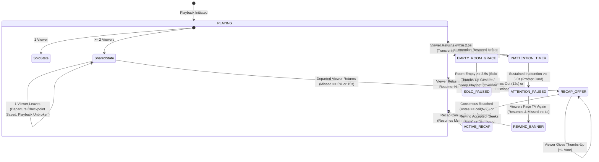

# LivingFrame Playback Intelligence Specification

**LivingFrame** features an intelligent media policy arbiter ([src/room/playbackIntelligence.ts](file:///home/supanroy/Projects/LivingFrame/src/room/playbackIntelligence.ts)) that governs how the television responds to changes in room presence, audience composition, and viewer attention.

---

## 1. Playback Intelligence Overview

Traditional media playback engines operate solely on explicit user commands (play, pause, seek). LivingFrame elevates playback into an environmental state machine that monitors the room dynamics and executes smooth, polite adaptations:



---

## 2. Policy Scenarios & State Machines

### Scenario A: Solo Viewer Dynamics

When a single person is watching a program:
1. **Departure Detection ($1 \to 0$)**:
   - When the sensor detects zero viewers, the engine schedules a pause event with a **$2.5\text{s}$ grace period**.
   - If the viewer was merely occluded or walking past the camera and returns within $2.5\text{s}$, the scheduled pause is cancelled with zero interruption.
2. **Empty-Room Pause**:
   - If the room remains empty past $2.5\text{s}$, the engine pauses playback and records a `SoloPauseCheckpoint`:
     ```typescript
     interface SoloPauseCheckpoint {
       titleId: string;
       playbackPositionSec: number;
       pausedAtMs: number;
     }
     ```
   - A non-intrusive notification pill appears on screen: *"Room empty · Playback paused"*.
3. **Seamless Resumption ($0 \to 1$)**:
   - When the viewer returns, playback automatically resumes from the exact second without displaying any recap modals (solo viewers never miss content while paused).

---

### Scenario B: Shared Viewing Dynamics & Arrival Recaps

When multiple people watch together:
1. **Departure During Group Viewing ($N \to N-1$, where $N-1 \ge 1$)**:
   - When one person steps away (e.g. to answer the door), playback **continues uninterrupted** for the remaining viewers.
   - The engine silently logs a `SharedDepartureCheckpoint` recording the departure timestamp and playback position:
     ```typescript
     interface SharedDepartureCheckpoint {
       titleId: string;
       departurePositionSec: number;
       durationSec: number;
       viewerCount: number;
       departureWallMs: number;
     }
     ```
2. **Eligibility Evaluation on Return ($N-1 \to N$)**:
   - When the departed viewer returns, the engine calculates missed progress:
     $$\Delta t = t_{\text{return}} - t_{\text{departure}}$$
     $$\text{missed\_progress} = \frac{\Delta t}{\text{durationSec}}$$
   - A recap offer is warranted if:
     $$\text{missed\_progress} \ge 0.05 \quad (5\%) \quad \text{or} \quad \Delta t \ge 15.0\text{s}$$
3. **Non-Blocking Recap Banner**:
   - An unobtrusive notification banner appears at the bottom of the screen: *"SOMEONE'S BACK · Catch them up?"*
   - Playback continues seamlessly in the background while the offer is active.
4. **Consensus Voting Engine**:
   - In shared sessions, a recap should not disrupt the group unless the audience agrees.
   - **Required Votes**:
     $$\text{requiredVotes} = \left\lceil \frac{N}{2} \right\rceil$$
   - **Voting Channels**:
     - **Remote Control**: Selecting "Show Recap" counts as instant host approval, immediately opening the recap.
     - **Natural Gestures**: Any viewer presenting a `thumbs_up` gesture increments the vote tally ($1/2$, $2/3$) with a $2.0\text{s}$ anti-repetition cooldown.
   - Once threshold consensus is reached, the movie pauses and displays the spoiler-free character/scene synopsis overlay (`AmbientRecapModal`).
   - Finishing the recap resumes the movie from the current timestamp without rewinding or restarting.

---

### Scenario C: Attention-Aware Viewing (Phase 2)

Perceives whether viewers are actively engaged with the television screen:
1. **Inattention Evaluation**:
   - The engine monitors the ratio of turned-away viewers:
     $$R_{\text{inattentive}} = \frac{N_{\text{distracted}}}{N_{\text{totalViewers}}}$$
   - When $R_{\text{inattentive}} > 0.70$ ($70\%$), an inattention timer initiates.
2. **Sustained Inattention Pause**:
   - If the inattentive state persists continuously for **$5.0\text{s}$**, playback pauses gently.
   - A subtle prompt card slides into view:
     ```text
     ┌─────────────────────────────────────────────────────────┐
     │ 👁️ ATTENTION-AWARE VIEWING                              │
     │ Playback paused · Viewers appear turned away            │
     │                                                         │
     │                 [ Keep Playing 👍 ]                     │
     └─────────────────────────────────────────────────────────┘
     ```
3. **Thumbs-Up Gesture Override**:
   - If viewers are engaged in conversation but wish playback to continue, any viewer can present a `thumbs_up` gesture (or click *Keep Playing* via the remote).
   - This latches `attentionOverride = true`, immediately unpausing playback and preventing further inattention interruptions for that session.
4. **Attention Restoration & Optional Rewind Offer**:
   - When viewers turn back to face the TV, playback automatically resumes.
   - If $\ge 4.0\text{s}$ of meaningful content was missed during inattention, an optional catch-up rewind banner appears:
     ```text
     ┌─────────────────────────────────────────────────────────┐
     │ ⏪ WELCOME BACK                                         │
     │ Catch up on 5s missed?                                  │
     │                                                         │
     │          [ Rewind 5s ]           [ Dismiss ]            │
     └─────────────────────────────────────────────────────────┘
     ```
   - Selecting **Rewind 5s** jumps back to the exact second inattention began; selecting **Dismiss** leaves playback at the current position.

---

### Scenario D: Family Mode & Scene Protection

1. **Dual-Header Preference Synchronization**:
   - Family Mode can be toggled from either the Home Screen top navigation bar or the Video Player header; both controls modify a unified persistent preference.
2. **Child Presence Gating**:
   - When Family Mode is enabled and a child enters the room, the engine cross-references the active playback timestamp against authored scene metadata (`item.sceneSafety`):
     ```typescript
     interface SceneSafetySegment {
       startSec: number;
       endSec: number;
       rating: 'family_safe' | 'adult_content';
       reason?: string;
     }
     ```
3. **Protection Response**:
   - If the active scene contains `adult_content` (or content rated `TV-14` / `TV-MA`), playback immediately pauses, the video surface is blacked out, and a child protection advisory modal covers the screen.
   - When the child leaves the room, playback automatically unmasks and resumes.

---

## 3. Playback Policy Action Reference

| Action Type | Originating Event | Action Payload | Visual & Playback Result |
|---|---|---|---|
| `PAUSE_SOLO` | Room empty $\ge 2.5\text{s}$ | `checkpoint: SoloPauseCheckpoint` | Pauses video; renders *"Room empty · Playback paused"* |
| `RESUME_SOLO` | Solo viewer returns | `positionSec: number` | Seeks to checkpoint; resumes playback |
| `RECORD_SHARED_DEPARTURE` | One viewer leaves group | `checkpoint: SharedDepartureCheckpoint` | Playback continues; departure logged silently |
| `OFFER_RECAP` | Viewer returns to group | `offer: RecapOfferState` | Renders bottom banner: *"SOMEONE'S BACK · Catch them up?"* |
| `START_RECAP` | Consensus vote reached | `resumePositionSec, metadata` | Pauses main video; displays full synopsis modal |
| `DISMISS_RECAP` | Offer timeout ($12\text{s}$) or dismissed | `reason: 'timeout' \| 'dismissed'` | Clears offer banner; movie continues unbroken |
| `PAUSE_ATTENTION` | Inattention $> 70\%$ for $\ge 5.0\text{s}$ | `checkpoint: AttentionDistractionCheckpoint` | Pauses video; renders attention prompt card |
| `OVERRIDE_ATTENTION` | Thumbs-up gesture / button | `resume: boolean` | Bypasses inattention lock; unpauses video |
| `RESUME_ATTENTION` | Attention restored | `autoResume, offerReplay, missedSec` | Resumes video; displays optional rewind banner if missed $\ge 4\text{s}$ |
| `NONE` | Transient blip or no change | None | No action |
